# Decodo n8n Node

This repository provides an n8n integration for **Decodo's Web Scraping API**, a powerful web scraping tool that automatically bypasses blocks and bot protection to extract data from any target URL. It's designed for developers and startups looking to automate data collection workflows from platforms like Google, eCommerce sites, and job boards.

[n8n](https://n8n.io/) is a [fair-code licensed](https://docs.n8n.io/reference/license/) workflow automation platform that lets you connect apps, APIs, and services to build automated workflows with minimal effort.

## Features

- **Easy integration**. Plug the Decodo's n8n node into existing workflows to start scraping with minimal setup.
- **Bypassing CAPTCHAs, rate-limits, and IP bans**. Automatic handling of common anti-bot defenses.
- **Geo-targeting**. Request region-specific results from websites that restrict content based on location.
- **Rotating proxy support to avoid IP bans**. Built-in proxy rotation to keep requests distributed and persistent.
- **Structured data output**. Get results in JSON or Markdown formats for easy readability and further analysis.

## Installation

Decodo is an official node integrated into n8n. To use it, simply:

1. Open the nodes panel.

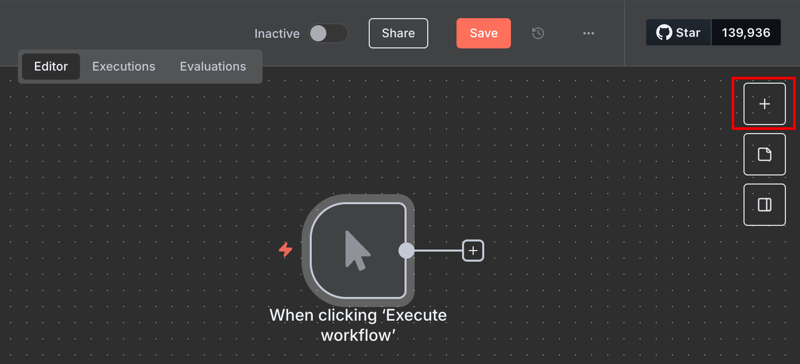

2. Search for "Decodo" to find the node.

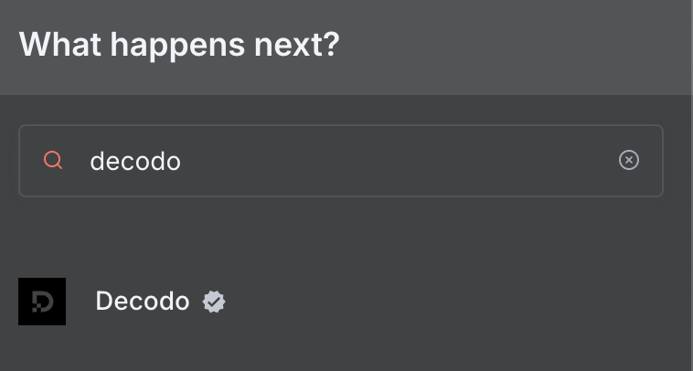

3. Click **+ Add to workflow**.

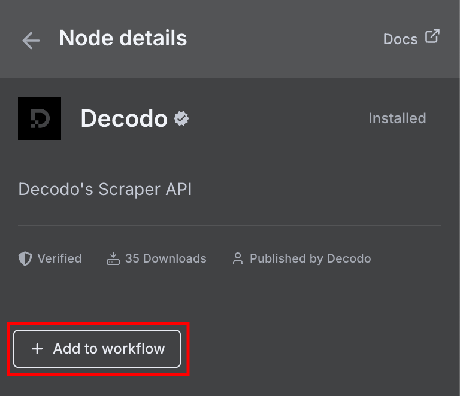

### Obtaining a Decodo account

The node requires a [Decodo Web Scraping API](https://decodo.com/scraping) Advanced plan. You can get started with a free trial on the [dashboard](https://dashboard.decodo.com/).

Once you have a plan activated, copy your Web Data API key from your Web Data API subscription on the [dashboard](https://dashboard.decodo.com/web-data/playground). Older plans only have a basic authentication token, which you can use in the same field:

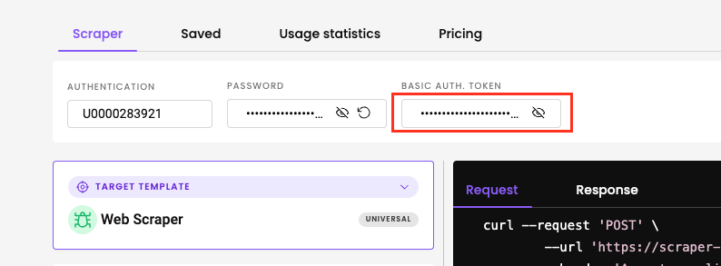

### Setting up credentials on n8n

1. Open the credentials window on n8n.

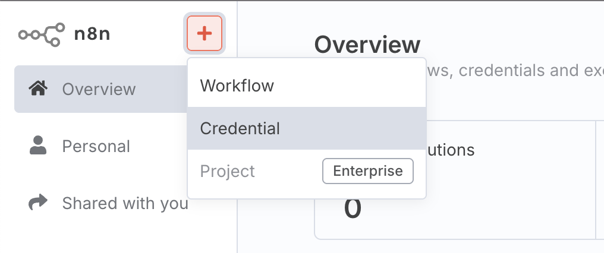

2. Create a new credential.

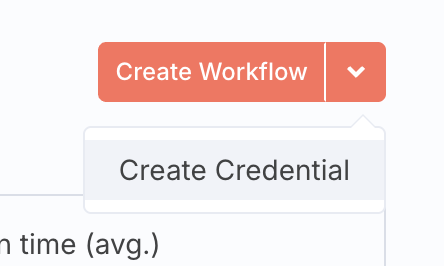

3. Find the _Decodo Credentials API_.

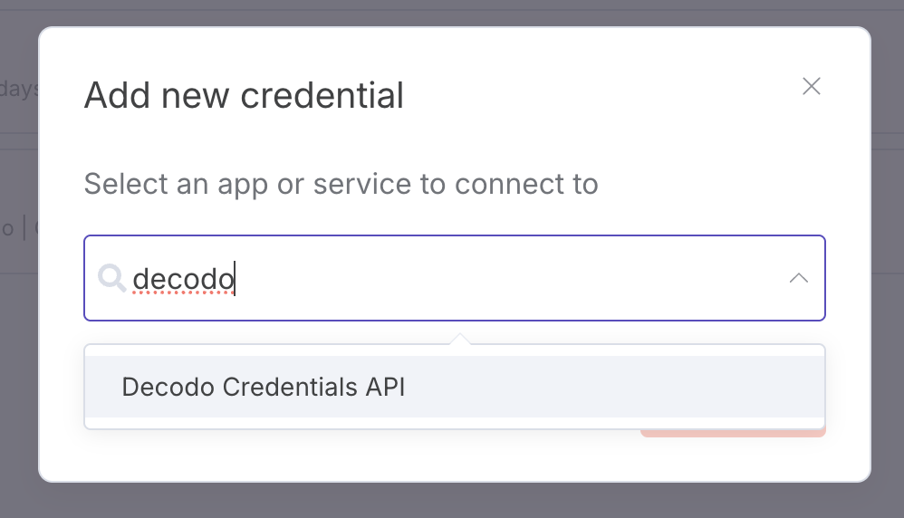

4. Paste your API key into the **Authentication Token** field. A basic authentication token works there too, and the credential detects which one you entered.

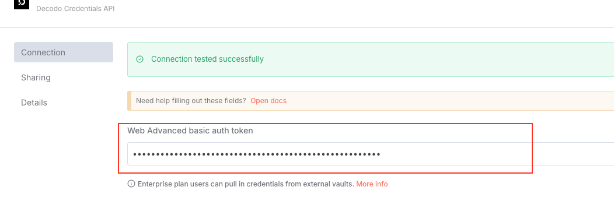

## Using the node

The node can be used in 2 ways - as an individual HTTP request node, or a tool for an AI agent.

### Individual node

To use the Decodo node by itself, connect it to an existing workflow. Once you add it, you can set the target **URL** and **Geolocation**.

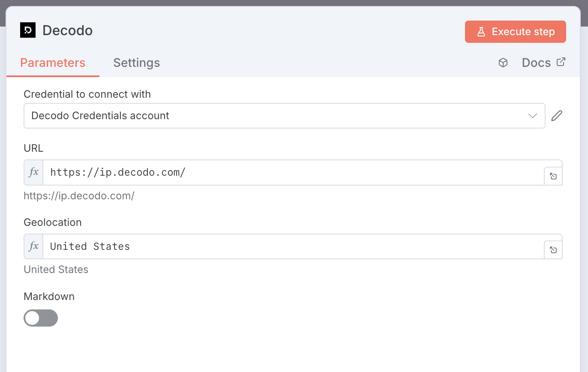

The node requests the target URL through a proxy in the chosen location, scrapes the page, and returns the response for use by downstream nodes such as the **HTML** node to extract content. Below is an example setup:

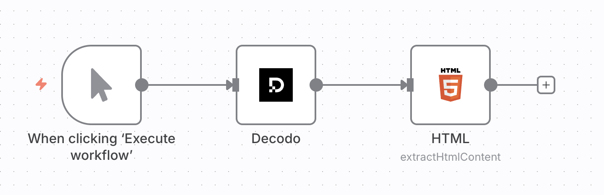

### AI agent tool

You can connect the Decodo node to the AI Agent node as a tool. You don't need to modify anything inside the node. Here's what a simple setup would look like:

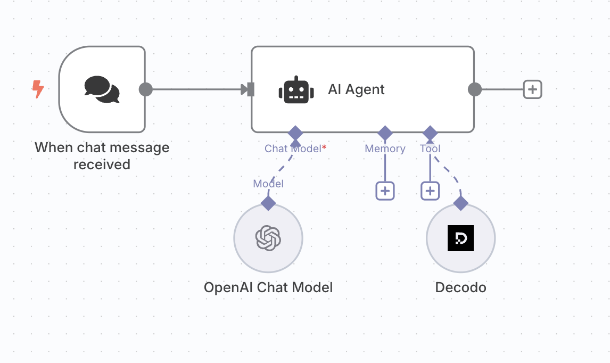

With this setup, you can prompt the agent to scrape a website in order to extract information. The prompt must be detailed and specific to return the best results.

**Bad prompt example**

If your AI model does not have access to the most recent web information, the following question may fail:

```
Who won the NBA in 2025?
```

**Good prompt example**

The question is more likely to be answered by updating the prompt with an instruction to scrape a reliable source:

```
Scrape Wikipedia and tell me who won the NBA in 2025.
```

## Targets

The node has a required **Target** dropdown that determines which Decodo scraping target is called and which other fields appear:

| Target | Primary input | Returns |
| --- | --- | --- |
| **Universal** | URL | Raw HTML, or Markdown with JS Rendering off |
| **Google Search** | Query | Parsed search results |
| **Amazon** | URL | Parsed product data |
| **YouTube Transcript** | Video ID | Transcript for one language |

> [!WARNING]
> **Don't use the YouTube Transcript target for now.** It relies on a retired API target and fails on every request. Until the node is updated, use [YouTube Subtitles](https://help.decodo.com/docs/web-scraping-api-youtube-subtitles) instead, called through n8n's **HTTP Request** node.

## Parameters

Which fields appear depends on the target you selected. A dash means the field is not offered for that target.

| Field | Sent as | Universal | Google Search | Amazon | YouTube Transcript |
| --- | --- | --- | --- | --- | --- |
| **URL** | `url` | Required | – | Required | – |
| **Query** | `query` | – | Required | – | – |
| **Video ID** | `query` | – | – | – | Required |
| **Language Code** | `language_code` | – | – | – | Required |
| **Transcript Origin** | `transcript_origin` | – | – | – | `auto_generated` |
| **JS Rendering** | `headless: "html"` | On | On | – | – |
| **Parse** | `parse` | – | On | On | – |
| **Geolocation** | `geo` | Optional | Optional | Optional | – |
| **Locale** | `locale` | – | Optional | – | – |
| **Results Amount** | `limit` | – | `10` | – | – |
| **Markdown** | `markdown` | Off | Off | – | – |

Where a value is shown instead of "Optional", that is the default the node starts with.

- **JS Rendering** is on by default and sends `headless: "html"`. Turning it off sends no rendering parameter at all.
- **Markdown** only appears once **JS Rendering** is turned off, so Markdown and JavaScript rendering can't be combined in this node.
- **Geolocation** takes a country name with a capital first letter, for example `United States`.
- **Locale** changes the language of the search page interface, not the language of the results, for example `en-US`.
- **Results Amount** accepts 1 to 100.

When the node is used as an AI agent tool, the agent fills these same fields from your message:

| Parameter | Example message |
| --- | --- |
| `url` | Scrape Wikipedia and tell me the article of the day. |
| `geo` | Scrape https://ip.decodo.com/json and tell me what city the request originated from. |
| `headless` | Scrape https://ip.decodo.com/json with JS rendering. |

If used as an individual node, all parameters can be manually configured by double-clicking on the node. For the full list of API parameters, see [Parameters](https://help.decodo.com/docs/web-scraping-api-parameters-overview).

## Development & releases

### Contribution

To contribute to this node:

1. Install n8n globally in your development machine.

```
npm install n8n -g
```

2. Pull this repository.

```
git clone https://github.com/Decodo/n8n-nodes-decodo.git

```

3. Navigate to the downloaded folder and build it.

```
cd n8n-nodes-decodo
npm install
npm run build
```

4. Inside the project folder, run `npm link` after building to make your local build of `@decodo/n8n-nodes-decodo` available in the local npm registry.
5. Inside `~/.n8n/custom`, run `npm link @decodo/n8n-nodes-decodo`.

See this [documentation page](https://docs.n8n.io/integrations/creating-nodes/test/run-node-locally) for more information.

### Releases

Releases are automated. Merging to `main` publishes a new version based on the
PR title, which must follow [Conventional Commits](https://www.conventionalcommits.org):
`fix:` → patch, `feat:` → minor, `feat!:` or a `BREAKING CHANGE:` footer → major.
`chore:`, `docs:`, `ci:`, `refactor:`, `test:` don't release. Don't edit the
version in the package manifest.

## Compatibility

The node requires **Node.js 20.15 or newer**. It has been developed and tested with:

- Node.js v22.17.0
- n8n nodes API version 1

## Resources

- [n8n community nodes documentation](https://docs.n8n.io/integrations/#community-nodes)
- [Decodo's Web Scraping API documentation](https://help.decodo.com/docs/web-scraping-api-introduction)

## Further reading

- [Complete guide for building n8n web scraping automations](https://decodo.com/blog/n8n-web-scraping-automation)
